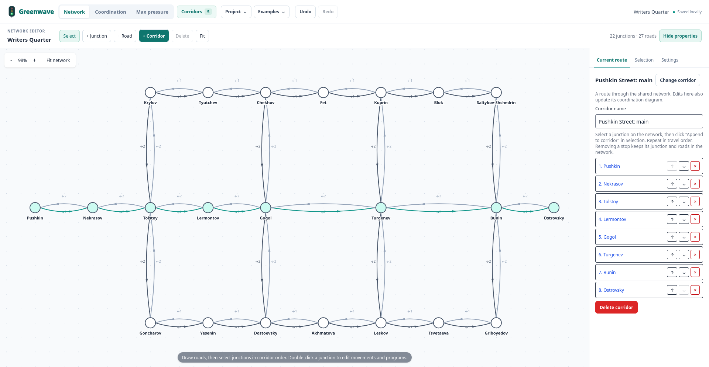
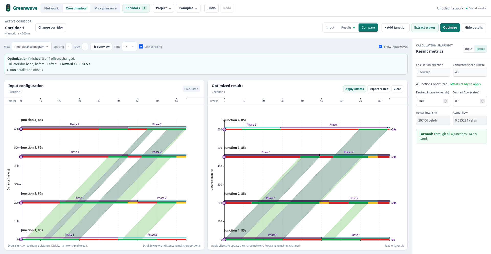
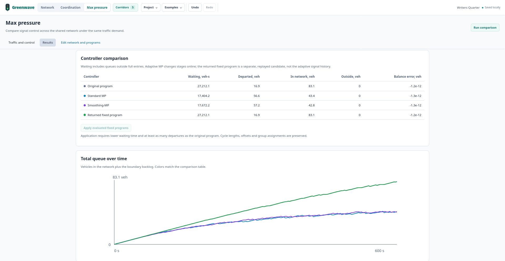
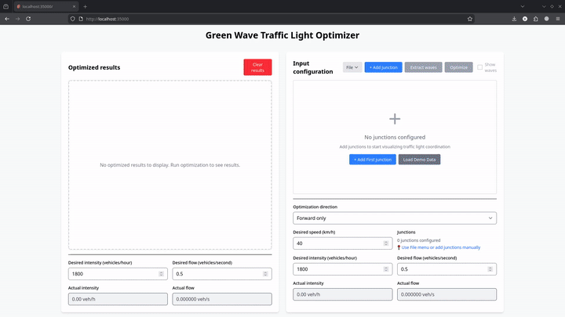
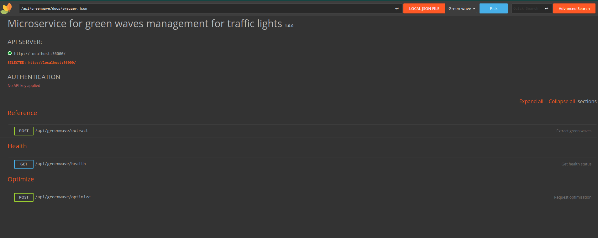

# Just a toy project to extract "green waves"

## About

This project is just a tool to see how ["green waves"](https://en.wikipedia.org/wiki/Green_wave) work in traffic light timing. It can find them along a corridor and try to get better offsets with a genetic algorithm, in one direction or both.

> Note: green waves can span repeated signal cycles, including trips longer than a cycle.

You can also play with network coordination using Standard Max-Pressure and experimental Smoothing-MP, pick corridors to coordinate, and compare queues, waiting and departures with fixed signal programs. That part is a queueing simulation: no individual cars or road travel times. The [network control model](./maxpressure/PAPER_MODEL.md) has the details and references.

The network editor and green-wave diagrams share single project. You can build junctions and programs, keep several corridors and traffic scenarios, edit turning shares right on the junction diagram, and compare before/after results. Autosave, JSON import/export and Undo/Redo are there too.

And guys don't use this in production. It's just a toy for understanding the basics and trying things out.

## Docker

### Build

```bash
./docker.sh
```

### Run

```bash
docker run -p 36000:36000 greenwave
```

### Usage

* Web UI: http://localhost:36000
* Swagger API docs: http://localhost:36000/api/greenwave/docs/

#### Web UI screenshots

Network editor



Green-wave optimization



Max pressure



#### Web UI Demo

The UI has had a pretty big rework recently, so these recordings are a bit out of date. The current editor and navigation look different, I'll try to update the recordings in further.

Forward direction only |
:-------------------------:|
 |

Both directions |
:-------------------------:|
 |

> Note: In the second recording, only the reverse direction got a "green wave" through all junctions, so vehicles per hour for the forward direction is zero. This metric counts traffic that can pass through the whole corridor within a green wave.

#### Swagger Documentation



### Custom configuration

```bash
docker run -p 35000:35000 \
    -e SERVER_HOST=0.0.0.0 \
    -e SERVER_PORT=35000 \
    -e SERVER_MAIN_PATH=api \
    -e SERVER_STARTUP_MESSAGE=true \
    -e USE_CORS=true \
    greenwave
```

Available environment variables:

| Variable | Default | Description |
|----------|---------|-------------|
| `SERVER_HOST` | `0.0.0.0` | Server bind address |
| `SERVER_PORT` | `36000` | Server port |
| `SERVER_MAIN_PATH` | `api` | API base path* |
| `SERVER_STARTUP_MESSAGE` | `true` | Show startup message |
| `USE_CORS` | `true` | Enable CORS |

\* `SERVER_MAIN_PATH`: The Web UI uses hardocded `/api/greenwave` and `/api/maxpressure`. Changing this variable requires updating these paths and rebuilding the UI.

Request and response schemas are available in the [Swagger specification](./app/rest/docs/swagger.json).

## Docker pull

### From GitHub сontainer registry

```bash
docker pull ghcr.io/lddl/greenwave:latest
docker run -p 36000:36000 ghcr.io/lddl/greenwave:latest
```

### From Dockerhub

```bash
docker pull dimahkiin/greenwave:latest
docker run -p 36000:36000 dimahkiin/greenwave:latest
```

## Swagger and REST API

* UI for [OpenAPI Spec Documentations](https://swagger.io/specification/) has been done via [rapidoc](https://rapidocweb.com/)

* JSON for Swagger has been prepared with [swaggo/swag](https://github.com/swaggo/swag).

* REST API part is written with usage of [labstack/echo](https://echo.labstack.com/).

* For logging [rs/zerolog](https://github.com/rs/zerolog) is used.

## Worth to mention

* [BurntSushi/toml](https://github.com/BurntSushi/toml) for TOML support
* [stretchr/testify](https://github.com/stretchr/testify) for testing tools

## References

1. Varaiya, P. (2013). [Max pressure control of a network of signalized intersections](https://doi.org/10.1016/j.trc.2013.08.014). Transportation Research Part C, 36, 177-195.
2. Kouvelas, A., Lioris, J., Fayazi, S.A., Varaiya, P. (2014). [Maximum pressure controller for stabilizing queues in signalized arterial networks](https://doi.org/10.3141/2421-15). Transportation Research Record, 2421(1), 133-141.
3. Xu, T., Barman, S., Levin, M.W. (2024). [Smoothing-MP: A novel max-pressure signal control considering signal coordination to smooth traffic in urban networks](https://doi.org/10.1016/j.trc.2024.104760). Transportation Research Part C, 166, 104760.
4. [go-gmns](https://github.com/LdDl/go-gmns): mesoscopic road graphs used by the network controller.
