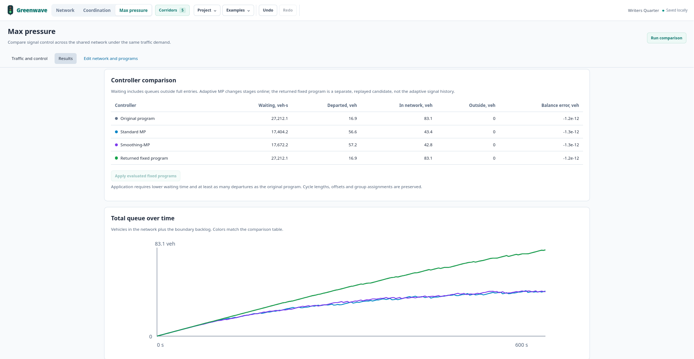

# Max pressure

Open "Max pressure" to compare signal control on the shared network. For a ready example, import [project.json](../../examples/maxpressure/project.json) through "Project" > "Open JSON".

## Prepare a scenario

"Duplicate scenario" copies traffic and control settings for another experiment. Roads, programs and movement assignments are shared across scenarios and edited in [Network](NETWORK_EDITOR.md).

| Setting | What to configure |
| --- | --- |
| Network boundaries | Entry and exit nodes. Their signals are excluded. To simulate an end intersection's signals, add an approach road and use its outer endpoint as the boundary. |
| Entry demand | Vehicles per hour on roads entering from the selected boundaries. Internal flows come from upstream junctions. These values are independent of corridor intensity. |
| Turning movements | Shares of each incoming flow, totaling 100% per incoming road. Edit in the table or with "Edit on diagram". Red totals block calculation. |
| Saturation and initial queue | Service rate during green in veh/h and starting queue in vehicles, per movement. Account for shared lanes when setting saturation. |
| Coordinated corridors | Routes receiving Smoothing-MP priority. Each needs at least four nodes and assigned through movements. Bidirectional routes include both directions. The whole network is still simulated. |
| Queue model | "Point queues" have unlimited space. "Finite road storage" limits space using road length and lanes. Demand that cannot enter waits outside. |

Defaults are 300 veh/h per entry, equal turning shares, 1800 veh/h saturation and empty queues. Review these assumptions for your network.

Set duration, time step, green bounds and clearance in "Control settings". Coordination weight α = 0 disables corridor priority. Resolve warnings about lengths, movement assignments, conflicts and turning totals, then press "Run comparison".

## Read the results

All four rows use the same traffic scenario:

| Controller | What is evaluated |
| --- | --- |
| Original program | The current fixed programs and offsets. |
| Standard MP | Adaptive signal control without corridor priority. |
| Smoothing-MP | Adaptive signal control with priority along selected corridors. |
| Returned fixed program | A separately tested fixed proposal. If no proposal was accepted, this row repeats the original program. |

"Waiting" adds up vehicle waiting time, including queues outside full entries. Ten vehicles waiting ten seconds contribute 100 veh·s. "Departed" counts vehicles that left the network. "In network" and "Outside" show those remaining inside and waiting to enter. "Balance error" should be close to zero.

"Total queue over time" includes queues inside and outside. "Movement queues under smoothing" shows average, maximum and final queues for individual movements.

This queue model has no road travel times or individual vehicle trajectories. Lower waiting does not establish a stop-free green wave. See [the algorithm and original papers](../../maxpressure/PAPER_MODEL.md) for the model and its limits.

## Apply programs

"Apply evaluated fixed programs" requires a fixed proposal with lower waiting and at least as many departures as the original program. Better adaptive MP results alone do not satisfy this check. The button also stays disabled while a run is active, after application, or after any project change. Rerun the comparison after editing.

Applying changes signal durations in the shared project. Cycles, offsets and group assignments are preserved. Every scenario uses the changed programs, and Undo restores them.

Scenario settings survive F5 and JSON export/import. Results survive navigation but disappear after F5.
