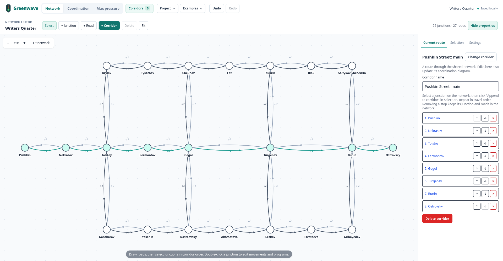

# Network and corridor editor

The diagram at `/` and the network at `/network` edit one project. The network holds all junctions, roads, movement assignments and signal programs. Each corridor selects an ordered route, forward/reverse groups, direction, speed and intensity. Switching corridors preserves branches and shares the same physical junctions.

## Network basics

| Thing | What it means |
| --- | --- |
| Junction | A physical intersection with a signal program and offset. |
| Road | Connects two junctions and stores length in meters and lane counts for each direction. |
| Movement | A path from an incoming road to an outgoing road, straight or turning. |
| Signal group | Controls its assigned movements with the same sequence of colors and durations. |
| Phase | One time block. Every group fills it, but can have different colors and switching times. |
| Program | Phases repeated as a cycle. The offset shifts the whole program. |
| Corridor | An ordered route with its own direction, speed, intensity and forward/reverse group choices. |

A few things to keep in mind:

- Dragging a node changes the drawing, not road length. The corridor diagram uses accumulated road lengths.
- Corridors share junction programs, offsets and movement assignments. Editing these affects other corridors using them.
- Removing a stop from a corridor keeps the junction. Deleting the junction removes it from every corridor.

## Workspace

Both views use the same top toolbar. "Network" edits roads and routes. "Coordination" shows the active corridor's diagrams. "Corridors" sits directly beside these views, followed by "Project", "Examples", Undo and Redo in the left part of the toolbar. Narrow screens place project actions on their own left-aligned row and retain every button's text label. Undo and Redo belong to the whole project. The project name and local-save status stay visible. Storage failures show an alert with a JSON backup action.

- "Project" contains "Open JSON", "Save project as JSON" and "New project". A project backup includes every corridor, road, assignment and program. "API input" contains export of the active corridor for integrations.
- "Examples" offers "Load demo data", a small four-junction corridor, and "Writers Quarter", a rectangular network with alternative routes.
- "Corridors" opens a panel on the left with names, lengths, directions and junction sequences. Select a route, use "+ Create corridor" above the list, or open its editing view. "Change corridor" opens this same list from the current view. A corridor is a route through the shared network, not a separate copy of the project.

On the network, the properties panel has "Current route", "Selection" and "Settings" sections. Click a junction or road to open its properties. Hide the panel when you need the whole canvas. At overview zoom levels, the canvas hides crowded names. Zoom in or select a junction to read its name.

## Build a network and choose a corridor

1. Open "Network" from the diagram. Existing input and "Load demo data" appear as a chain with the same junctions and complete programs.
2. Use "+ Junction" to place nodes. Choose "+ Road", select its endpoints, and enter length in meters and lane counts. One road represents both directions. Select it to change its length, lanes or direction.
3. Click "+ Corridor" beside "+ Road" on the Network toolbar to create a route. "Current route" opens and focuses its name, even if properties were hidden. You can also create one from "Corridors" using "+ Create corridor" above the list. Select a junction on the canvas and click "Append to corridor" in "Selection". Repeat in travel order. Reorder or remove stops in "Current route". The active route is highlighted on the canvas.
4. Connect consecutive stops and set physical road lengths. Bidirectional routes require travel in both directions on every road. Missing connections, lengths, directions and movement assignments are reported before calculation.
5. Double-click junctions to edit programs and groups. Open "Coordination" to edit and calculate the same corridor.

Removing a stop from a corridor preserves its junction, program and roads. Deleting a junction from the network removes incident roads and its references in every corridor. Removing a middle stop does not invent a shortcut road. Undo restores the complete change.

Canvas coordinates describe layout only. Dragging a graph node does not change distances. Diagram distances accumulate along the selected route. Moving a diagram junction changes the corresponding road lengths. Adding a junction from the diagram appends it to the active corridor. Adding one on the graph leaves it outside corridors until selected for a route.

Roads support 1 to 12 forward lanes and 0 to 12 reverse lanes. Zero reverse lanes means one-way traffic relative to the road's stored direction. Switching to bidirectional calculation adds return lanes only for an untouched chain generated from input. After manual network or route editing, configure directions explicitly. Reverse calculation follows the same roads and uses the same programs and offsets.

## Rectangular example: Writers Quarter

Open "Examples" > "Writers Quarter" to load 22 junctions, 27 two-way roads and five corridors: a main route, two bypasses and two cross-street routes. Loading it replaces the current project. Undo restores it.

Forward and reverse groups are already selected. Programs use a 120 s cycle with separate through and protected-turn groups. Offsets are not optimized. Use it to try different routes and edit junction programs.



## Junction programs and movements

"Edit intersection" and a double-click open the same dialog used by the diagram. It contains the graphical intersection, a signal timeline and "Movements", "Groups" and "Program" sections. Junctions outside the active corridor expose their programs and movements without corridor group controls or corridor distance.

A permanent signal group owns its signals across every phase. Assign each movement to one group, or leave it "Forbidden". A group can control several movements. New movements start forbidden. The preview slider shows their colors at the selected time, including the junction offset, without changing the program.

"Forward group" and "Reverse group" select coordination signals for this junction in the active corridor. Changing a selection also assigns that group's actual corridor movement in the draft. "Same as forward" inherits the forward selection. A sole group is implicit. Several groups require an explicit choice. Endpoints have no invented external approaches, so their groups remain editable even without a complete movement arc.

Selections belong to corridors. Assignments and programs belong to the physical junction. A selection that disagrees with an assigned movement produces an error. The editor does not silently alter another corridor's selection. Groups referenced by movements or any corridor cannot be removed until those references change.

Use "Groups" to add permanent groups, initially red for each phase's duration. In "Program", add or remove phases and signals and edit colors, durations and offsets. Clicking a timeline interval opens its group and duration field. Groups must have equal total duration within each phase, though individual switching times may differ. Mismatches identify the affected phase and prevent Save until corrected. Imported inconsistent programs remain available for inspection and repair.

Conflicts combine geometric crossings and shared exits with overlapping green or yellow intervals, including different controlling groups. Selecting a pair highlights both arcs. A shared entry alone is not a conflict. This is an approach-level editing aid, not a lane-level traffic model. Conflicting drafts can be saved. U-turn arcs are not generated.

The dialog has local Undo and Redo. "Save" applies the program, selections and assignments as one project history action. Cancel and Escape ask before discarding changes. Removing roads or directions clears unavailable movement assignments and preserves unaffected ones. Project Undo restores both topology and assignments.

## Calculation and results

"Input" and "Results" each use the available chart width. A successful "Optimize" opens "Compare" automatically, with both diagrams and result metrics. Desktop chart headers and plot areas align, and "Link scrolling" keeps their viewports together. On narrower windows, comparison stacks the charts. Results are labeled with the corridor used for that calculation, even after the active route changes.

"Optimize" also calculates the original input waves, so both sides are ready to compare without a separate "Extract waves" action. The run summary shows how many offsets changed and the full-corridor bands before and after. "Run details and offsets" lists individual offsets, longest connected waves and the search score. These values describe the input at the start of the run, including after "Apply offsets" makes the two diagrams identical. Optimization changes offsets only, preserving phases and groups. Partial waves can improve while full-corridor flow stays zero.

Wave calculation follows departures during one cycle of the first junction in each direction. Programs repeat at each junction, so arrivals can occur many cycles later. Returned times stay absolute. With unequal cycle lengths, results describe this departure window rather than the full common period.

"Time axis" defaults to "Elapsed time", showing actual time and both calculated directions, with band slopes determined by speed. Bounded windows keep long trips readable, with "Earlier", "Later", a start-time field and "Last arrival". Compare shares the time representation, departure direction and horizontal scale, and synchronizes the selected time window when "Link scrolling" is enabled.

"Departure time" is an optional compact view. X is departure time at the route origin, covering its first cycle. Each signal row is shifted by cumulative travel time at the selected speed. A vertical band through all junctions identifies departures that reach every selected signal on green. "View direction" selects forward or reverse for bidirectional corridors. The chart names its origin and speed, and labels the travel time to each junction. Hover over bands and signals for absolute passage times. Program offsets remain unchanged. Unequal cycles use the same departure window. Outdated input departure bands are hidden until recalculation. Results retain their own calculation speed and program snapshot, with an outdated warning when the input changes.

Long corridors retain readable spacing between nearby junctions and scroll inside the plot instead of being compressed to the window height. Distances remain linear and proportional. The time ruler stays visible while scrolling. "Spacing" adjusts vertical detail, "Time" zooms horizontally, and "Fit overview" deliberately fits the whole route. "Readable spacing" returns to detailed inspection. Keyboard focus on a chart enables native scrolling. Coincident junction distances show an overlap notice. Change their distances to separate them.

"Settings & metrics" contains direction, speed, intensity and flow, together with the read-only calculated indicators. It can be hidden to enlarge the graph. In comparison, switch this panel between input and result. Result direction and calculated speed describe its own calculation snapshot. Input validation and outdated-result warnings remain visible above the workspace even with the panel hidden.

Each direction still reports pending, outdated, empty, partial or full-corridor results. Reverse indicators explain inherited forward groups and groups without green signals. Different forward/reverse selections produce two labeled signal rows. All programs and unselected groups remain intact. Reverse indicator transitions respect reduced-motion preferences.

"Signal strip preview" is the former Road view. It displays static signal strips and their state at t=0, accounting for offsets. It does not animate traffic or phase switching. Use the junction editor's time slider to inspect movement colors within a program.

"Apply offsets" changes only the active corridor's junction offsets in the shared network, preserving programs, assignments, unrelated junctions and layout. It reuses both calculated wave arrays without another request. Undo restores the offsets together. Switching corridors or editing calculation data blocks application of the old result. Layout and intensity changes do not. F5 restores input but not results or history.

The example `tests/fixtures/bidirectional-turns.json` uses Pushkin Street, Nekrasov Street, Tolstoy Street and Krylov Street, a 120-second cycle, G10 for forward, G20 for reverse, G30 for a protected turn and G40 for a cross street. Initial offsets 0, 45, 90 and 45 are uncoordinated. Reference offsets 0, 9, 19 and 30 produce through bands of 28 and 20 seconds. Import creates corridor roads only. Draw side roads and assign their movements to display the other groups geometrically.

## Save and import

The complete project is automatically saved under `greenwave.project.v1`. Programs, roads, assignments, corridors, settings and layout survive F5. Unsaved dialog drafts, history and results do not. Storage belongs to the site's origin, so another port or browser has separate data.

"Project" > "Save project as JSON" saves the complete `greenwave-project` version 1 document. "Export corridor for API" under "API input" saves only the selected input projection. It is intended for API integration, not full-project backup. "Export result" in the results chart saves the optimized program snapshot and its selected groups in the existing result format.

Import accepts `greenwave-project` version 1 and corridor input/result JSON with junctions and calculation settings. Validation happens before replacement. Loading input JSON or demo data replaces the entire project with its generated corridor network. The prompt states that scope. Both pages use the same replacement dialog with incoming counts and an action to save the current project. Imports larger than 5 MB are rejected. Replacements can be undone during the session. Malformed files leave the project unchanged.

Input files with nonstraight coordinates are projected using distances along their original point sequence. Travel distances and complete programs are preserved. The diagram uses accumulated route distance rather than the original two-dimensional geometry.

Storage failures leave editing available in memory and show an error. Export a copy to preserve work. Opening the page does not overwrite an unreadable saved value or silently substitute another project.

## Keyboard and history

| Action                                           | Shortcut                            |
| ------------------------------------------------ | ----------------------------------- |
| Select tool                                      | V                                   |
| Add junction tool                                | N                                   |
| Add road tool                                    | R                                   |
| Fit network                                      | F                                   |
| Delete selection from network                    | Delete or Backspace                 |
| Cancel drawing or selection                      | Escape                              |
| Undo                                             | Ctrl/Cmd+Z                          |
| Redo                                             | Ctrl/Cmd+Shift+Z or Ctrl/Cmd+Y      |
| Pan focused canvas                               | Arrow keys                          |
| Zoom focused canvas                              | + or -                              |
| Place junction at canvas center in Junction mode | Enter                               |
| Select focused junction or road                  | Enter or Space                      |
| Move focused junction in Select mode             | Arrow keys, Shift for a larger step |

Dragging pans the canvas in Select mode. The wheel and view buttons change zoom. Selecting two focused junctions in Road mode connects them. Shortcuts do not intercept text fields or operate behind dialogs. Both pages share up to 100 history steps. A drag is one step. Dialogs keep their own draft shortcuts. Project shortcuts do not act behind dialogs or intercept text fields.

## Development checks

Run from `web/greenwave-ui`:

```sh
pnpm test
pnpm check
pnpm build
```

Model tests cover validation, persistence failures, multiple corridors, references, conflicts, history, projection and result application. After UI changes, also check network creation, route selection, movement assignments, draft history, import/export, reload, diagram edits, stale calculation responses, keyboard controls and narrow screens.
